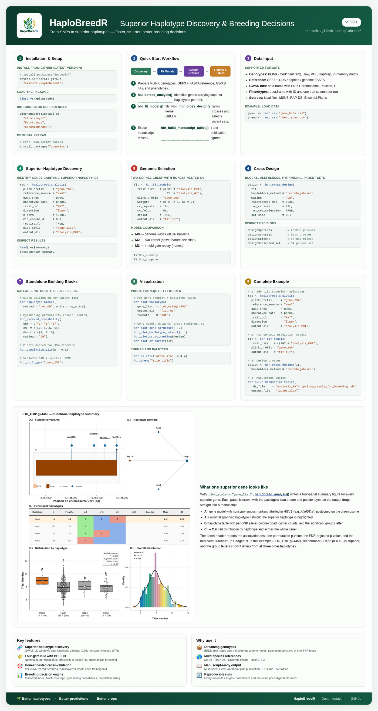
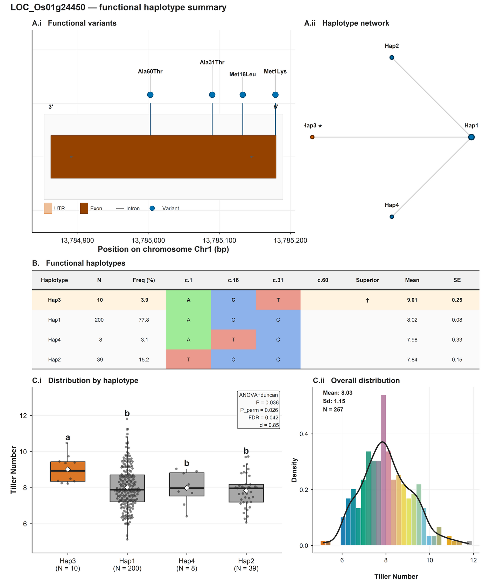

# HaploBreedR 

<!-- badges: start -->
[](https://github.com/aksruchi/HaploBreedR/actions/workflows/R-CMD-check.yaml)
[](https://github.com/aksruchi/HaploBreedR/actions/workflows/pkgdown.yaml)
[](https://lifecycle.r-lib.org/articles/stages.html#stable)
[](https://opensource.org/licenses/MIT)
<!-- badges: end -->

**Superior haplotype discovery and haplotype-guided genomic selection for crop breeding.**

HaploBreedR is an end-to-end quantitative genomics and molecular
breeding suite. It identifies superior functional haplotypes from
nonsynonymous CDS and UTR variants under false discovery rate control,
fits two-kernel spectral REML genomic prediction models with the
pipeline's superior haplotypes as a feature kernel, performs
haplotype-guided cross-usefulness prediction and linkage-aware
pyramiding optimization, and selects diverse parent sets with a
relatedness ceiling.

📊 **[One-page infographic](https://aksruchi.github.io/HaploBreedR/infographic.html)** (https://aksruchi.github.io/HaploBreedR/reference/figures/HaploBreedR_infographic.png) — the pipeline at a glance.
<p align="center">
  <a href="https://aksruchi.github.io/HaploBreedR/infographic.html">
    
  </a>
  <br>
  <em>One-page infographic — the pipeline at a glance</em>
</p>

<p align="center">
  
  <br>
  <em>Example per-gene figure produced by <code>haplobreed_analysis(plot_style = "gene_list")</code></em>
</p>
*A four-panel summary for a single superior gene: gene model, haplotype network, haplotype table, and trait distribution. Produced automatically by `haplobreed_analysis(plot_style = "gene_list")`.*
---

## Installation

```r
# install.packages("devtools")
devtools::install_github("aksruchi/HaploBreedR")